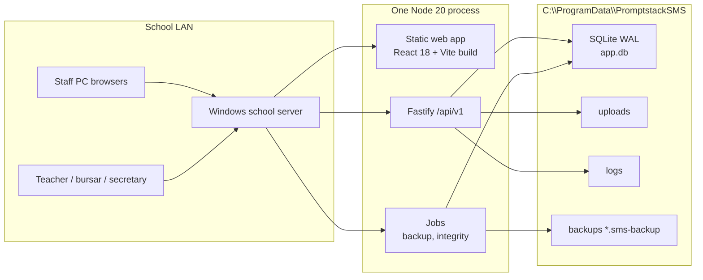
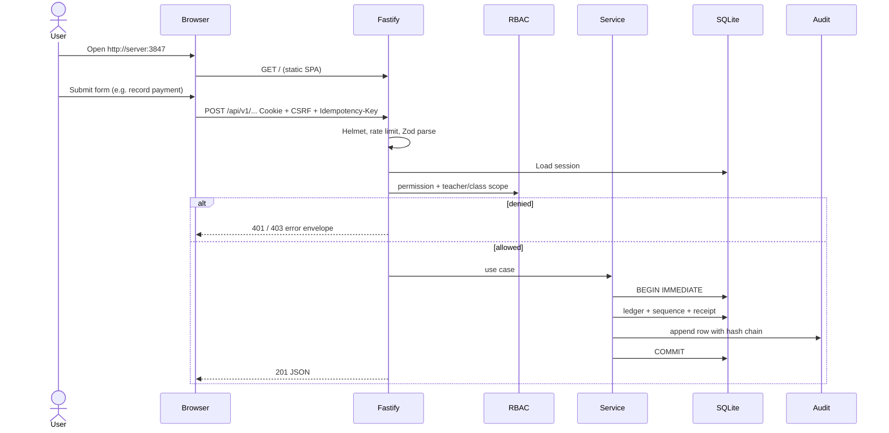
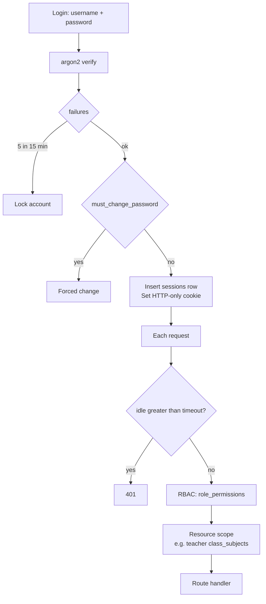
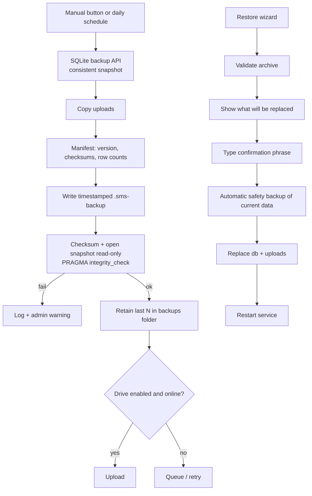

# Architecture

Promptstack School Management is a **single-process local web application**. One Windows PC is the school server. Staff browsers on the LAN are the only clients. There is no cloud runtime for core features.

## 1. System overview

- **apps/web**: React 18, React Router, TanStack Query/Table, RHF+Zod, Tailwind (purple/white tokens), Recharts, i18n.
- **apps/server**: Fastify, Zod, sessions, RBAC, modules, pdfmake, exceljs, jobs.
- **packages/shared**: schemas, permission catalogue, money helpers, grading/ranking (pure functions).
- **installer/** (Phase 8): bundled Node, NSSM service, firewall, desktop shortcut, Inno Setup.

Clients never talk to SQLite. All writes go through the API so permissions, validation, audit, and sequences stay in one place.

## 2. Windows server deployment

Target: one Windows 10/11 PC that stays on during school hours (and preferably overnight for scheduled backup).

| Piece | Behaviour |
|---|---|
| Installer | Inno Setup copies Node + app into Program Files, creates `C:\ProgramData\PromptstackSMS\`, writes a machine session secret, opens TCP 3847 on Private networks, registers NSSM service `PromptstackSMS`, shortcut “Open School System” |
| Service | Auto-start, restart on crash, stdout/stderr to `logs\` with rotation |
| Process | `node apps/server` (or compiled entry) serving static UI + API |
| Upgrade | New installer stops service → copies files → starts service. On start: pre-migration backup, Drizzle migrate, then listen. Failure: do not listen; keep previous backup |
| Server status | Admin page shows hostname, LAN IPs, `http://<ip>:3847`, QR code, version, last backup, disk free |
| Offline | No phone-home. Optional Drive upload is a queued job |

Dev machines use `pnpm dev` (Vite + Fastify) with `.data/` instead of ProgramData.

## 3. Request flow

Conventions:

- REST `/api/v1/...`, JSON, shared types.
- Errors: `{ error: { code, message, fields? } }`.
- List endpoints: page, pageSize, sort, filters; indexes sized for 5,000 pupils / 100,000 transactions.
- Financial writes: `BEGIN IMMEDIATE` so two cashiers cannot mint the same receipt number.
- SPA routing: Fastify falls back to `index.html` for non-API GETs.

## 4. Auth and permissions

**Roles (defaults, Super Admin editable):** Super Admin, Proprietor/Management, Headteacher, Accountant/Bursar, Secretary/Admissions, Teacher, HR/Administrator.

**Permissions** are `resource:action` strings (example: `payments:create`, `payments:reverse`, `payments:approve`, `pupils:update`, `payroll:view`, `system:backup`). The UI hides nav items the user lacks; the server still checks.

**Sensitive fields:** `pupils.medical_notes`, `staff.national_id`, salary columns — omitted unless the permission is present.

**Maker-checker:** `approval_requests` for reversals, discounts above threshold, payroll finalise, cash-up reopen. Approver ≠ maker.

**Audit:** every write stores who, when, IP/workstation, module, action, entity id, before JSON, after JSON, reason, `prev_hash`, `row_hash`. Users are disabled, never deleted, so audit attribution remains.

## 5. Backup design

Rules:

- Never copy a live `app.db` with the file API; always the SQLite backup API so WAL is consistent.
- Restore refuses to proceed without a fresh safety backup.
- Admin dashboard: red warning if no successful backup in 48 hours.
- Drive is optional, off by default, never required to run the school.

## 6. Module map (logical)

| Area | Server module | Web features |
|---|---|---|
| Foundation | `auth`, `rbac`, `audit`, `config`, `db` | Shell, login, wizard, settings |
| Structure / pupils | `academic`, `admissions`, `pupils` | Structure, applications, directory |
| Finance | `fees`, `expenses` | Payments, receipts, cash-up, expenses |
| People | `staff`, `payroll` | HR, payroll runs, payslips |
| Learning | `academics`, `attendance` | Marks grid, report cards, registers |
| Ops | `reports`, `inventory`, `admin`, `backup`, `system` | Reports, stock, health, restore |

Shared rules (money, sequences, grading, permissions) live in `packages/shared` and are unit-tested there; the server is the only place they are applied to data.
