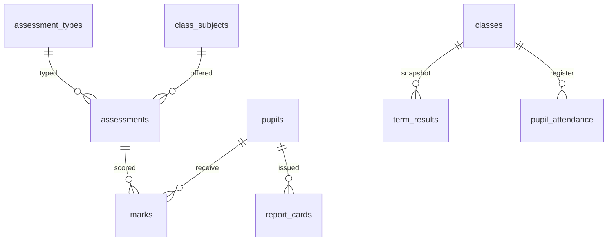

# Data model (Phase 5)

Academics sit beside the academic tree from Phase 2. Marks may be fractional; money remains INTEGER FCFA elsewhere. Term results are recomputed snapshots, not live views. Payments stay append-only.

