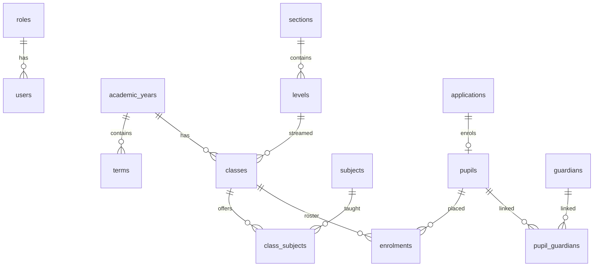

# Data model (Phase 2)

Foundation tables: `school_profile`, `academic_years`, `terms`, `sections`, `levels`, `users`, `roles`, `permissions`, `role_permissions`, `sessions`, `login_attempts`, `audit_log`, `settings`, `number_sequences`.

Pupil tables: `classes`, `subjects`, `class_subjects`, `grading_scales`, `grading_scale_bands`, `applications`, `pupils`, `pupil_status_history`, `guardians`, `pupil_guardians`, `enrolments`, `promotion_batches`, `discipline_notes`.

Primary keys are UUIDv7. Admission numbers are `ABC-{YEAR}-{SEQ:4}` from a per-year sequence, issued only on enrolment. Enrolment is unique per pupil per academic year. Payments (later) stay INTEGER FCFA. Audit rows are append-only with `prev_hash` / `row_hash`.
