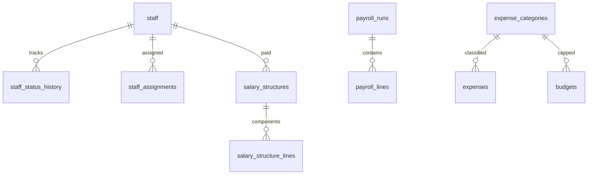

# Data model (Phase 4)

Staff, payroll, and expenses sit beside the Phase 3 fee ledger. Salary and expense amounts are INTEGER FCFA. Finalised payroll runs are not edited in place (next-period correction).

