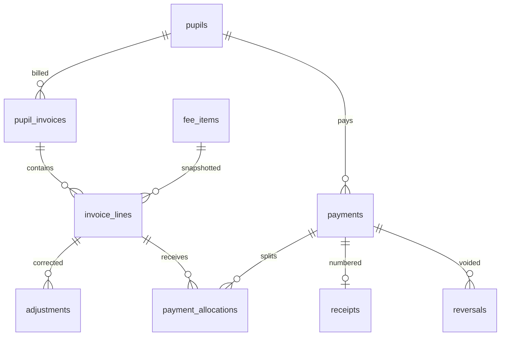

# Data model (Phase 3)

Foundation, pupils, and fees. Money columns are INTEGER FCFA. Payments, allocations, receipts, reversals, adjustments, and audit rows are append-only.

Balances = invoice lines + applied adjustments − net allocations. Receipt numbers come from `number_sequences.receipt` in the same transaction as the payment.
