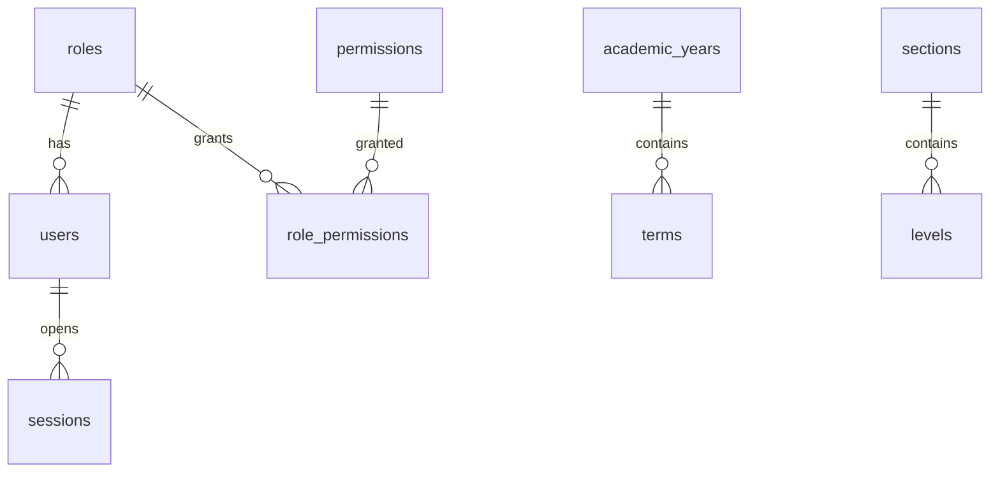

# Data model (Phase 1)

Foundation tables: `school_profile`, `academic_years`, `terms`, `sections`, `levels`, `users`, `roles`, `permissions`, `role_permissions`, `sessions`, `login_attempts`, `audit_log`, `settings`, `number_sequences`.

Primary keys are UUIDv7. Money (later) is INTEGER FCFA. Audit rows are append-only with `prev_hash` / `row_hash`.
