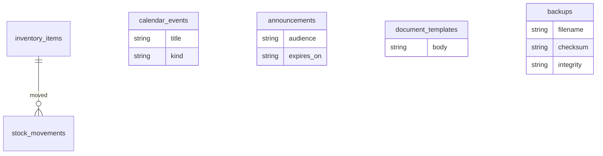

# Data model (Phase 7)

`backups` records each archive (checksum, counts, integrity, drive queue status). Quantity and money rules from earlier phases are unchanged.

Inventory quantity is the sum of `stock_movements.qty` (in positive, out negative). Calendar, announcements, and letter templates are school-admin tables.

